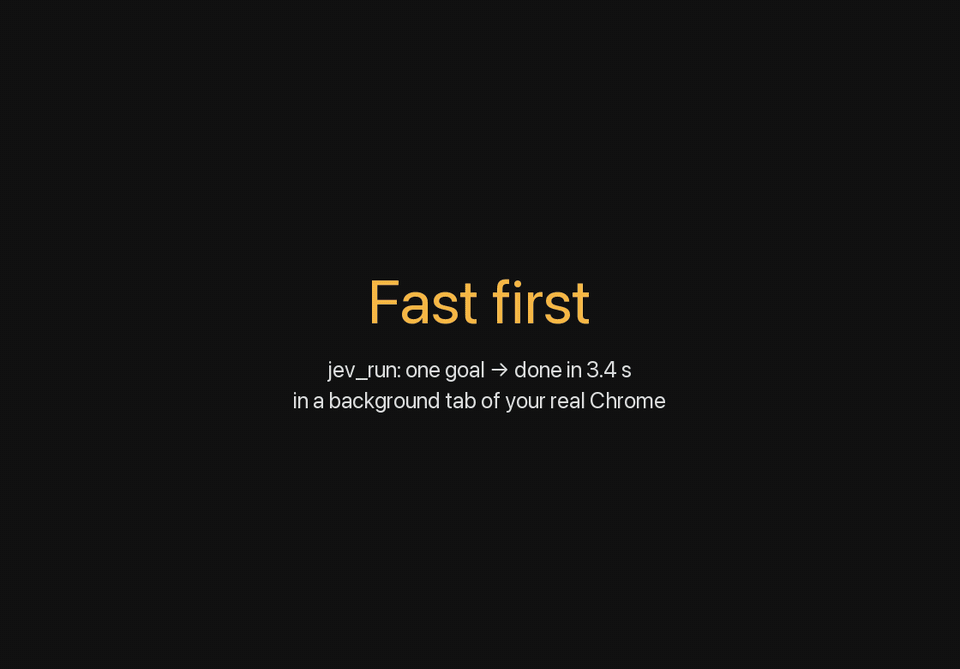

# jev-browser

**Fast browser control for Claude Code: one goal to done in ~3 seconds, in a background tab of your real Chrome.**

A Claude Code plugin that gives Claude the full [Claude in Chrome](https://code.claude.com/docs/en/chrome) tool set over the Chrome DevTools Protocol, plus [Jev Ultrafast](https://github.com/browser-use/jev-ultrafast), an autonomous agent that finishes narrow web tasks in 2 to 8 seconds.



- **Background tabs.** Agent tabs never come to the front, so your keyboard and focus stay yours.
- **Fast.** `jev_run` turns one goal into a finished page in 2 to 8 seconds. With the step-by-step tools in speed mode (the default), each action takes about 0.1 s.
- **Separate cursor.** Input goes straight into the tab through CDP. Your own mouse cursor never moves. The page shows its own orange agent cursor.
- **Human mode, when a site needs it.** For sites that react to robotic mouse movement, say "switch to human mode": curved paths with overshoot and varied timing from [ghost-cursor](https://github.com/Xetera/ghost-cursor), about 0.7 s per move. Claude still stops at CAPTCHAs and hands them to you. `JEV_CURSOR_MODE=natural` makes it the default.
- **Tab groups.** Each Claude session's tabs go into an orange group named after the task, like `Jev · Add 5 items to cart`, renamed when the task changes.
- **Learns sites.** Each action Claude names ("add to cart") is remembered per page type, so it applies to every product page, not just one. Next time it's a single `act` call, and multi-step flows replay with `run_workflow`. Memory lives in `~/.jev/memory`, encrypted (AES-256-GCM, key in your OS keychain: macOS Keychain, Windows Credential Manager or Linux Secret Service; file names hashed so they don't reveal sites), and never stores what you typed.
- **Your logins.** Claude works in the Chrome profile you're already signed into. It stops and hands over at login pages and CAPTCHAs.
- **Loaded automatically.** Installed at user level, so every Claude Code session has the tools without extra flags.

## Install

Works on macOS, Linux and Windows. You need Chrome (or Edge/another Chromium browser), [Claude Code](https://code.claude.com), [uv](https://docs.astral.sh/uv/) and Node 18 or later.

**1. Run the installer** (about 1 minute):

```bash
curl -fsSL https://raw.githubusercontent.com/MaciejWiatr/jev-browser/main/install.sh | bash
```

On Windows, in PowerShell:

```powershell
irm https://raw.githubusercontent.com/MaciejWiatr/jev-browser/main/install.ps1 | iex
```

It clones Jev Ultrafast into `~/.jev/jev-ultrafast`, installs its dependencies and adds the plugin to Claude Code.

**2. Let Claude connect to Chrome:** open `chrome://inspect/#remote-debugging` and turn it on. Click **Allow** when Chrome asks.

**3. Optional, tab groups:** open `chrome://extensions`, turn on **Developer mode**, click **Load unpacked** and pick `~/.jev/tab-groups-extension`.

**4. Optional, the `jev_run` agent:** put your keys in `~/.jev/jev-ultrafast/.env`:

```bash
TYPESAFE_API_KEY=...      # https://docs.typesafe.ai
TEXT_MODEL_API_KEY=...    # OpenRouter key, or "ollama" with TEXT_MODEL_BASE_URL=http://localhost:11434/v1
```

Every other tool works without any keys.

<details>
<summary>Manual install, without the script</summary>

```bash
git clone https://github.com/browser-use/jev-ultrafast ~/.jev/jev-ultrafast
(cd ~/.jev/jev-ultrafast && uv sync && cp .env.example .env)
claude plugin marketplace add MaciejWiatr/jev-browser
claude plugin install jev@jev-browser --scope user
```

If Jev Ultrafast lives somewhere else, set `JEV_HOME`.
</details>

## Use it

Start a new Claude Code session and ask in plain words:

```text
Open localhost:3000, submit the signup form with an invalid email and check the error message and console.
```

```text
Use jev to find one-way flights Warsaw → Barcelona on November 14, 1 adult.
```

```text
Go to the product list, extract name, price and stock for every item into products.csv.
```

```text
Record a GIF of the checkout flow up to the payment page, then stop.
```

Claude goes ultra-fast first: it starts with `jev_run`. It falls back to the step-by-step tools when a run gets blocked, or when the task needs debugging, uploads, recordings or a lot of judgment. The bundled skills tell it when to stop for you and how to check the result.

## Tools

| Group | Tools |
| --- | --- |
| Tabs | `tabs_context`, `tabs_create`, `tabs_close`, `navigate` (url, back, forward, reload), `resize_window` |
| Read | `read_page` (elements with refs like `[n12]`, visible text, login/CAPTCHA detection), `get_page_text`, `find` |
| Act | `computer` (click, type, key, scroll, hover, wait, screenshot, zoom), `form_input`, `javascript_tool`, `file_upload`, `browser_batch` |
| Memory | `act`, `save_workflow`, `run_workflow`, `site_memory`; `intent=` on `computer` and `form_input` teaches it |
| Debug | `read_console_messages`, `read_network_requests`, `gif_creator`, `handle_dialog` |
| Agent and setup | `jev_run`, `jev_status` (status and reconnect, like `/chrome`), `set_cursor_mode`, `jev_inspector` |

Compared with Claude in Chrome, it doesn't support choosing between several connected browsers, or the extension's saved shortcuts and scheduled tasks.

## Safety

- Claude only touches tabs it opened in the current session.
- It pauses at login pages and CAPTCHAs, reports JS dialogs, and asks before anything irreversible.
- Uploads are capped at 10 MB and refuse credential files (`.env`, keys, `~/.ssh`, …) and hard-linked files.
- Block or allow sites in `~/.config/jev/sites.json`:

  ```json
  { "allow": [], "deny": ["*.mybank.com"] }
  ```

  An empty `allow` list means every site except the denied ones.
- Model output never becomes a CSS selector or a coordinate the agent made up. Element refs point at nodes Jev observed on the page.
- GIFs and screenshots show whatever is in the tab, account details included. That covers pop-ups that password managers and Chrome autofill draw inside the page (name, phone, email). Review every frame before sharing a recording, or record in a Chrome profile without autofill data.

## Configuration

Set these in the `env` section of your Claude Code settings. The cursor mode can also be switched in any session by asking Claude (`set_cursor_mode`).

| Variable | Default | Effect |
| --- | --- | --- |
| `JEV_HOME` | `~/.jev/jev-ultrafast` | Where Jev Ultrafast is installed |
| `JEV_CURSOR_MODE` | `speed` | `speed`: instant moves, fastest. `natural`: human mode, ghost-cursor paths for sites that flag robotic input |
| `JEV_CURSOR_MAX_MS` | `600` | Natural mode: longest time one cursor move may take |
| `JEV_GROUP_TITLE` | `Jev · <folder>` | Tab group name |
| `JEV_VIEWPORT` | fills the window | Pin a fixed page size, e.g. `1440x900` (`jev_run` always uses 1120x780 while it runs) |
| `JEV_MEMORY_DIR` | `~/.jev/memory` | Learned actions and workflows, one encrypted file per site |
| `JEV_MEMORY` | `on` | `off` disables memory and its tools |
| `JEV_SITES_FILE` | `~/.config/jev/sites.json` | Site allow/deny rules |

## Troubleshooting

Ask Claude to "run jev_status". It reports the Chrome connection, which keys are set (never their values), the site rules and the open tabs.

| Symptom | Fix |
| --- | --- |
| `DevToolsActivePort not found`, daemon not alive | Turn on `chrome://inspect/#remote-debugging` |
| Tools time out | A JS dialog may be open: ask Claude to handle it. Otherwise run `jev_status` with reconnect |
| No `jev` tools in Claude | Run `/mcp` to read the server error, `/plugin` to check that `jev` is enabled |
| No tab groups | Load the extension (install step 3) |

## How it works

```text
Claude Code ──MCP stdio──▶ server/jev_mcp.py ──▶ Browser Harness daemon ──CDP──▶ your Chrome
                              │                                                    │
                              ├─ Jev snapshot.js: atomic DOM read, element refs     ├─ background tabs
                              ├─ cursor.bundle.js: ghost-cursor paths (Node)        └─ extension: tab groups
                              └─ jev_run: TypeSafe operation/target heads + small LLM
```

- `server/jev_mcp.py`: the MCP tools.
- `server/browser_tools.py`: tabs, input, the console/network/dialog event pump, GIF recording.
- `server/cursor/`: the ghost-cursor helper. Rebuild it with `npm i && npm run build`.
- `extension/`: the tab-groups extension. It wakes on Chrome tab events and keeps no open connection.
- `skills/`: instructions Claude loads automatically.

## Development

```bash
uv run --with "mcp>=1.2,<2" python tests/e2e.py   # 18 end-to-end checks through the MCP server, no paid calls
claude plugin validate .
uv run --project ~/.jev/jev-ultrafast --env-file ~/.jev/jev-ultrafast/.env --with pillow python scripts/record_demo.py   # re-record docs/demo-v3.gif (needs ffmpeg, one paid jev_run)
```

## Credits

[Jev Ultrafast](https://github.com/browser-use/jev-ultrafast) and [Browser Harness](https://github.com/browser-use/browser-harness) by Browser Use (MIT), [ghost-cursor](https://github.com/Xetera/ghost-cursor) by Xetera (ISC, bundled). See [THIRD_PARTY_NOTICES.md](THIRD_PARTY_NOTICES.md).

This is an independent project. It isn't affiliated with Anthropic, Browser Use or TypeSafe.

## License

MIT
